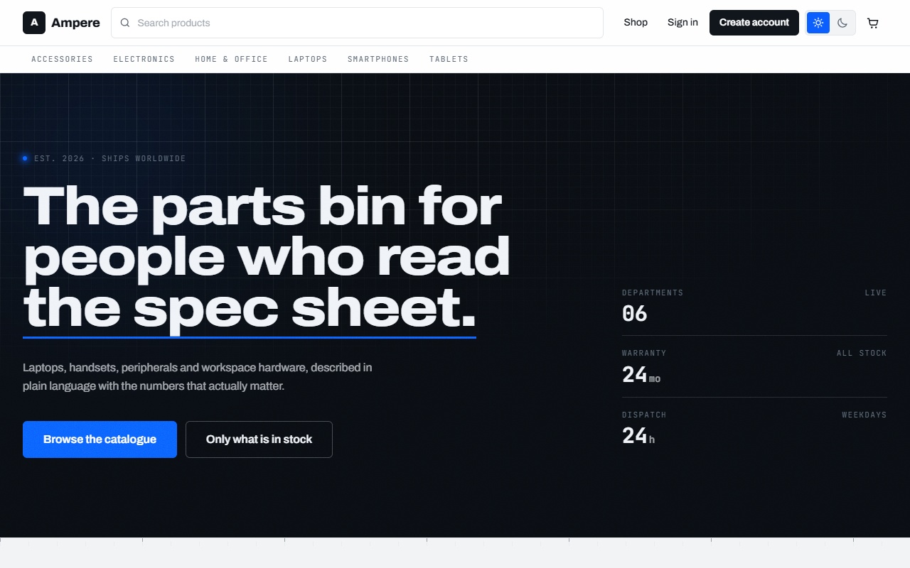
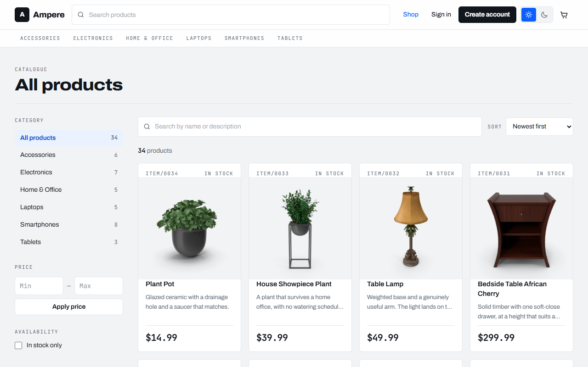
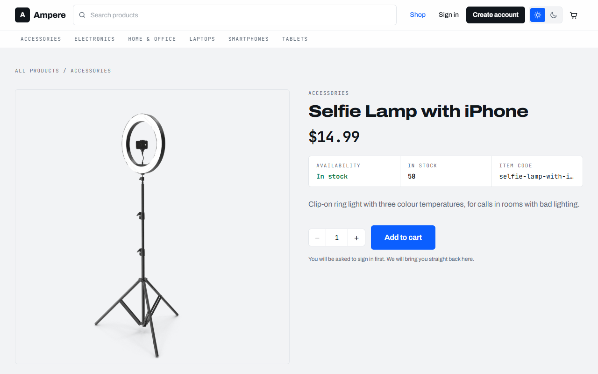
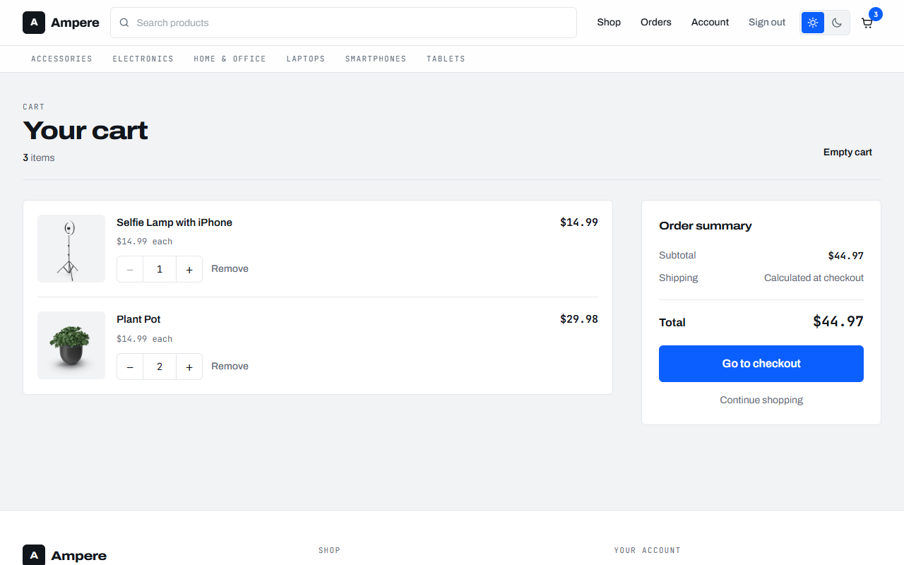
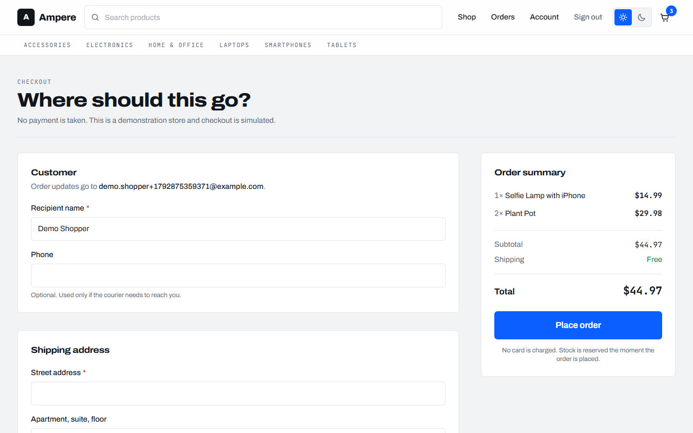
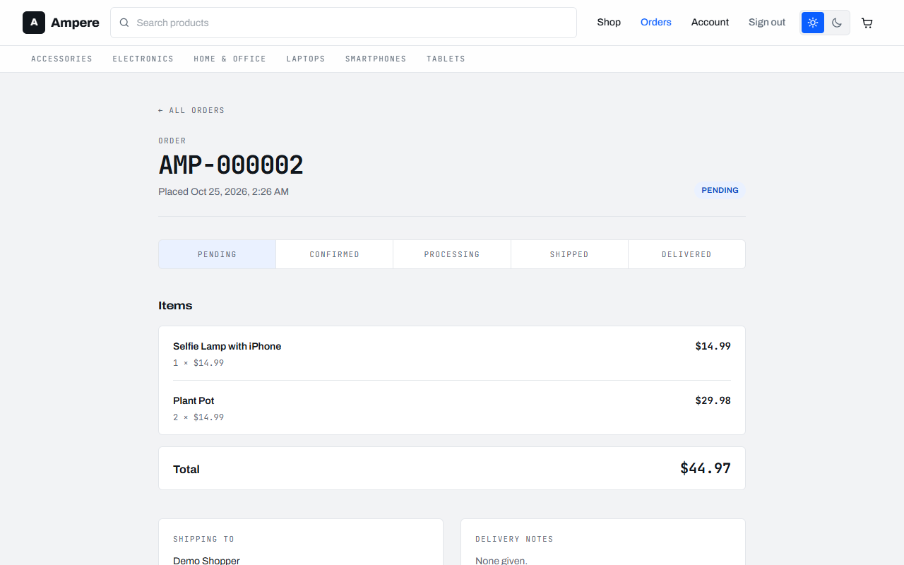
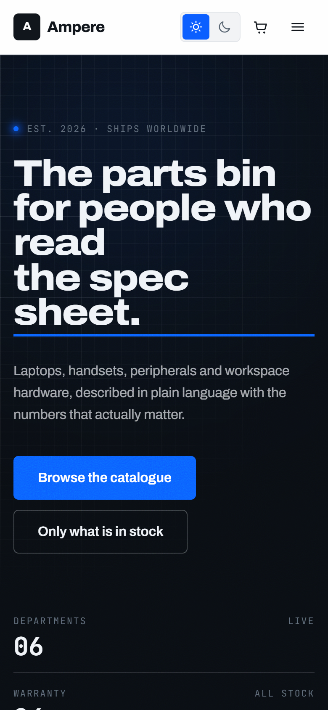
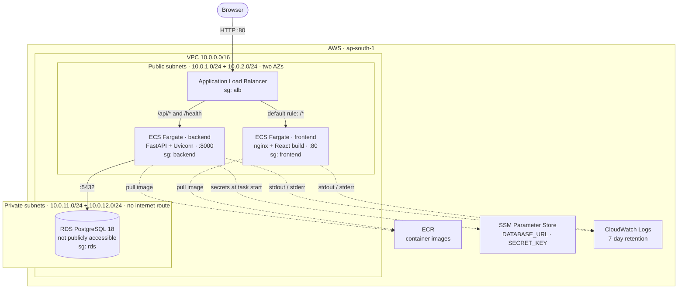

# Production-Grade E-Commerce Platform on AWS

A full-stack e-commerce store (FastAPI, React and PostgreSQL), containerised with
Docker and deployed to AWS with Terraform: ECS Fargate behind an Application Load
Balancer, a private RDS PostgreSQL database, images in ECR, secrets in SSM
Parameter Store and logs in CloudWatch.

**Status:** deployed and verified on AWS (`ap-south-1`, October 2026). The site,
API, database, authentication, cart, checkout and order history were all tested end
to end through the public load balancer; see [Verification](#verification).
CI/CD, HTTPS and alerting are not built yet; see [Roadmap](#roadmap).

**What this project demonstrates**

- **Infrastructure as code.** Every AWS resource lives in Terraform (a VPC across
  two availability zones, security groups, an ALB, ECS, RDS, ECR, IAM and
  CloudWatch). There is no click-ops.
- **Layered network security.** Only the load balancer accepts internet traffic.
  The containers accept traffic only from the load balancer, and the database
  accepts it only from the backend.
- **Secrets kept out of everything.** Secrets never appear in Git, Terraform source
  or the ECS task definition. ECS injects them from SSM Parameter Store when a task
  starts, and the IAM policy can read exactly those two parameters.
- **Safe deployments.** ECS replaces tasks only after the new one passes its health
  check, and the circuit breaker rolls back automatically when one doesn't. The
  backend health check makes a real round trip to the database.
- **Cost-aware design.** Running the containers in public subnets with locked-down
  security groups avoids a NAT gateway, which would cost about $40 a month.
- **A real application underneath.** It has JWT auth with refresh tokens, a checkout
  that can't oversell under concurrency, money handled as decimals throughout, and
  131 backend tests running against real PostgreSQL.

---

## Screenshots

These were captured from the live AWS deployment (browser → ALB → ECS Fargate →
RDS) on 25 October 2026.



| Catalogue: category, price and stock filters | Product detail |
|---|---|
|  |  |
| **Cart: server-side, per user** | **Checkout: simulated, no payment taken** |
|  |  |
| **Order placed, with status timeline** | **Mobile layout (390 px)** |
|  |  |

---

## Contents

- [Screenshots](#screenshots)
- [Architecture](#architecture)
- [Technology stack](#technology-stack)
- [AWS deployment](#aws-deployment)
  - [What is deployed](#what-is-deployed)
  - [Network and security model](#network-and-security-model)
  - [How secrets are handled](#how-secrets-are-handled)
  - [Deploying from scratch](#deploying-from-scratch)
  - [Releasing a new version](#releasing-a-new-version)
  - [Verification](#verification)
  - [Costs](#costs)
  - [Pausing and cleaning up](#pausing-and-cleaning-up)
  - [Troubleshooting](#troubleshooting)
- [Running locally with Docker Compose](#running-locally-with-docker-compose)
- [Local development without Docker](#local-development-without-docker)
- [Environment variables](#environment-variables)
- [Database migrations](#database-migrations)
- [Seed data and the admin account](#seed-data-and-the-admin-account)
- [API documentation](#api-documentation)
- [API endpoints](#api-endpoints)
- [Frontend routes](#frontend-routes)
- [Testing](#testing)
- [Development commands](#development-commands)
- [Project structure](#project-structure)
- [Design notes](#design-notes)
- [Known limitations](#known-limitations)
- [Roadmap](#roadmap)

---

## Architecture

### On AWS



**How a request flows.** The browser only ever talks to the ALB, so the site and
its API share one origin:

- The listener sends `/api/*` and `/health` to the backend target group.
- Everything else goes to the frontend, where nginx serves the compiled React app
  and falls back to `index.html` for client-side routes such as `/products`.

Because the frontend calls relative `/api/...` paths, there is no CORS
configuration to maintain and no API URL baked into the JavaScript bundle.

### Inside the application

```
                   Browser
                      │
                      │  REST + JWT (Bearer)
                      ▼
        ┌─────────────────────────────┐
        │  Frontend — React 19 + Vite │
        │  TypeScript (strict)        │
        │  Tailwind CSS v4            │
        └──────────────┬──────────────┘
                       │  fetch, via a single API client
                       ▼
        ┌─────────────────────────────┐
        │  Backend — FastAPI          │
        │  ┌───────────────────────┐  │
        │  │ api/      routers     │  │
        │  │ schemas/  Pydantic    │  │
        │  │ services/ logic       │  │
        │  │ models/   SQLAlchemy  │  │
        │  │ core/     security    │  │
        │  └───────────────────────┘  │
        └──────────────┬──────────────┘
                       │  SQLAlchemy 2.0 ORM
                       ▼
        ┌─────────────────────────────┐
        │  PostgreSQL 18              │
        │  schema owned by Alembic    │
        └─────────────────────────────┘
```

Requests flow router → service → model:

- **Routers** handle HTTP concerns and validation.
- **Services** hold logic that spans more than one table; checkout is the
  substantial one.
- **Models** own the schema.

Pydantic schemas are the contract at the edge: nothing reaches a client except
through a declared response type.

More detail is in [`docs/architecture.md`](docs/architecture.md). The reasoning
behind specific choices is logged in [`docs/decisions.md`](docs/decisions.md), and
[`docs/audit.md`](docs/audit.md) records what each engineering audit checked and
changed.

## Technology stack

### Application

| Layer | Choice | Version |
|---|---|---|
| Backend framework | FastAPI | 0.141.1 |
| ORM | SQLAlchemy | 2.0.54 |
| Migrations | Alembic | 1.20.0 |
| Database | PostgreSQL | 18 |
| Driver | psycopg2-binary | 2.9.13 |
| Validation / config | Pydantic, pydantic-settings | 2.13.5 / 2.15.0 |
| Password hashing | bcrypt | 5.0.0 |
| Tokens | PyJWT | 2.14.0 |
| Backend tests | pytest, httpx | 9.1.1 / 0.28.1 |
| Backend lint | ruff | 0.16.8 |
| Frontend framework | React | 19.2 |
| Build tool | Vite | 7.3.6 |
| Language | TypeScript (strict) | 6.0 |
| Styling | Tailwind CSS | 4.3.3 |
| Routing | react-router-dom | 7.18.4 |
| Frontend lint | oxlint | 1.83 |

### Infrastructure

| Concern | Choice | Detail |
|---|---|---|
| Infrastructure as code | Terraform, AWS provider | 1.16 / 6.67, provider pinned by `.terraform.lock.hcl` |
| Containers | Docker, multi-stage builds | `python:3.10-slim` backend; `node:22-alpine` build → `nginx:alpine` frontend |
| Compute | Amazon ECS on Fargate | 0.25 vCPU / 512 MB per task, `linux/amd64` |
| Load balancing | Application Load Balancer | HTTP :80, path-based routing |
| Database | Amazon RDS for PostgreSQL | 18.3, `db.t3.micro`, 20 GB gp3, private |
| Image registry | Amazon ECR | Immutable tags, scan on push |
| Secrets | SSM Parameter Store | `SecureString`, injected by ECS at task start |
| Logs | Amazon CloudWatch Logs | `awslogs` driver, 7-day retention |
| Region | `ap-south-1` (Mumbai) | Two availability zones |

## AWS deployment

All Terraform lives in [`infrastructure/terraform/`](infrastructure/terraform/),
one file per concern:

| File | Defines |
|---|---|
| `vpc.tf` | VPC, internet gateway, two public and two private subnets, public route table |
| `security_groups.tf` | `alb`, `frontend`, `backend` and `rds` security groups |
| `alb.tf` | Load balancer, two target groups, HTTP listener, `/api/*` routing rule |
| `ecs.tf` | Cluster, two task definitions, two services |
| `iam.tf` | Task execution role and its read access to the two backend secrets |
| `rds.tf` | DB subnet group and the PostgreSQL instance |
| `ecr.tf` | `ecommerce-backend` and `ecommerce-frontend` repositories |
| `logs.tf` | One CloudWatch log group per service |
| `variables.tf`, `outputs.tf`, `providers.tf` | Inputs (region, image tags, DB password), outputs (`alb_url` and others) |

### What is deployed

| Component | Configuration |
|---|---|
| **ALB** `ecommerce-platform-alb` | Internet-facing, in both public subnets. Drops invalid header fields |
| **Frontend service** | 1 Fargate task. Target group health check: `GET /` returns `200` |
| **Backend service** | 1 Fargate task. Health check: `GET /health` returns `200`, which also proves database connectivity. 120 s grace period for startup migrations |
| **Deployments** | Rolling, with the ECS deployment circuit breaker and automatic rollback. 30 s connection draining |
| **RDS** `ecommerce-platform-postgres` | Single AZ, `publicly_accessible = false`, 1-day automated backups |
| **ECR** | Backend image `v1.0.0`, frontend image `v1.0.1` |

### Network and security model

Each layer accepts traffic only from the layer in front of it:

| Security group | Inbound | From |
|---|---|---|
| `alb` | 80, 443 | `0.0.0.0/0` (the internet) |
| `frontend` | 80 | the `alb` security group only |
| `backend` | 8000 | the `alb` security group only |
| `rds` | 5432 | the `backend` security group only |

- **The database is private.** It sits in subnets with no route to the internet,
  is not publicly accessible, and only the backend's security group can reach it.
- **The tasks run in the public subnets with a public IP, but they are not
  reachable from the internet.** The public IP exists so a task can pull its
  image from ECR, write logs to CloudWatch and read its secrets from SSM without a
  NAT gateway. Inbound, the security groups admit the load balancer and nothing
  else. See [Design notes](#infrastructure-decisions) for the cost comparison.
- **No task role.** The application makes no AWS API calls, so the containers hold
  no AWS credentials. ECS uses the separate *execution* role to pull images, ship
  logs and fetch secrets on the task's behalf.

### How secrets are handled

| Secret | Stored in | Who can read it |
|---|---|---|
| `DATABASE_URL` | SSM `/ecommerce-platform/backend/DATABASE_URL` (`SecureString`) | The ECS execution role, for that parameter only |
| `SECRET_KEY` (JWT signing) | SSM `/ecommerce-platform/backend/SECRET_KEY` (`SecureString`) | The ECS execution role, for that parameter only |
| RDS master password | `terraform.tfvars` (gitignored) and therefore Terraform state | Whoever holds the local state file |

- The parameters are created with the AWS CLI, **outside Terraform**. Terraform
  knows only their ARNs, so the values never appear in `.tf` files, the plan, the
  state or the task definition. For the same reason the code deliberately avoids a
  `data "aws_ssm_parameter"` lookup, which would copy the value into state.
- **Kept out of Git** by [`.gitignore`](.gitignore):
  - `.env` and `.env.*` (`.env.example` stays tracked)
  - `*.tfvars` and `*.tfvars.json`
  - `*.tfstate` and `*.tfstate.*`
  - the `.terraform/` directory
- The AWS account ID isn't committed either; it is looked up at plan time.

### Deploying from scratch

The commands below are Windows PowerShell, the shell this project was built and
deployed with, and they run from `infrastructure/terraform/` unless stated.

**Prerequisites:**
- AWS CLI v2, signed in to an identity that can manage these services
- Terraform 1.6 or newer
- Docker

**1. Set the database password.** Create `infrastructure/terraform/terraform.tfvars`
(it is gitignored) containing:

```hcl
db_password = "a-long-random-password"
```

**2. Create the network, database and image registries first.** The ECS services
need images and secrets that can't exist until the registries and the database
do, so bootstrap those with a targeted apply. Expect about 10 minutes, mostly
spent creating RDS.

```powershell
terraform init
terraform apply -target="aws_ecr_repository.backend" -target="aws_ecr_repository.frontend" -target="aws_db_instance.postgres"
```

**3. Build and push both images.** Tags are immutable, so every build gets a new
tag. Build for `linux/amd64`, the architecture the task definitions specify.

```powershell
$acct = aws sts get-caller-identity --query Account --output text
$reg  = "$acct.dkr.ecr.ap-south-1.amazonaws.com"
# Windows PowerShell 5.1 corrupts the token when piping into docker; let cmd do the pipe.
cmd /c "aws ecr get-login-password --region ap-south-1 | docker login --username AWS --password-stdin $reg"

docker build --platform linux/amd64 -t "$reg/ecommerce-backend:v1.0.0"  ..\..\backend
docker build --platform linux/amd64 -t "$reg/ecommerce-frontend:v1.0.1" ..\..\frontend
cmd /c "docker push $reg/ecommerce-backend:v1.0.0"
cmd /c "docker push $reg/ecommerce-frontend:v1.0.1"
```

**4. Create the two secrets.** This script reads the password from
`terraform.tfvars` in memory, so `DATABASE_URL` always matches RDS and nothing is
echoed to the screen:

```powershell
$pw = [regex]::Match((Get-Content .\terraform.tfvars -Raw), 'db_password\s*=\s*"((?:[^"\\]|\\.)*)"').Groups[1].Value
$host_ = aws rds describe-db-instances --region ap-south-1 --db-instance-identifier ecommerce-platform-postgres --query "DBInstances[0].Endpoint.Address" --output text
$dbUrl = "postgresql+psycopg2://postgres:$([uri]::EscapeDataString($pw))@${host_}:5432/ecommerce_db"
$bytes = New-Object byte[] 48; [Security.Cryptography.RandomNumberGenerator]::Create().GetBytes($bytes)
$secretKey = [Convert]::ToBase64String($bytes).TrimEnd('=').Replace('+','-').Replace('/','_')
aws ssm put-parameter --region ap-south-1 --name /ecommerce-platform/backend/DATABASE_URL --type SecureString --value $dbUrl --query Version
aws ssm put-parameter --region ap-south-1 --name /ecommerce-platform/backend/SECRET_KEY --type SecureString --value $secretKey --query Version
Remove-Variable pw, host_, dbUrl, bytes, secretKey
```

**5. Create everything else.** This adds the ALB, the frontend security group, the
task definitions and the services. Read the plan before applying it.

```powershell
terraform plan
terraform apply
```

The backend task runs `alembic upgrade head` before starting Uvicorn, so the
schema is created on the first start.

**6. Load the catalogue.** The seed script runs as a one-off ECS task that uses
the backend task definition with a different command. It is idempotent, so a
re-run adds only what is missing.

```powershell
'{"containerOverrides":[{"name":"backend","command":["python","-m","app.seed"]}]}' | Set-Content -Encoding ascii seed.json
$subnets = (terraform output -json public_subnet_ids | ConvertFrom-Json) -join ','
$sg      = terraform output -raw backend_security_group_id
aws ecs run-task --region ap-south-1 --cluster ecommerce-platform-cluster --launch-type FARGATE `
  --task-definition ecommerce-platform-backend --overrides file://seed.json `
  --network-configuration "awsvpcConfiguration={subnets=[$subnets],securityGroups=[$sg],assignPublicIp=ENABLED}"
Remove-Item seed.json
```

**7. Open the site.** Run `terraform output -raw alb_url`, then follow
[Verification](#verification) to check it.

### Releasing a new version

1. Build and push the changed image with a **new** tag, for example
   `ecommerce-backend:v1.0.1`. ECR rejects re-pushing an existing tag.
2. Bump `backend_image_tag` or `frontend_image_tag` in
   [`variables.tf`](infrastructure/terraform/variables.tf) and commit it, so Git
   records what is deployed.
3. Run `terraform apply`. ECS then rolls out the new version:
   - It starts a task with the new image.
   - It waits for the target group to report it healthy.
   - It drains the old task.

   If the new task never becomes healthy, the circuit breaker rolls back to the
   previous version.

**Rotating a secret.** Overwrite the parameter
(`aws ssm put-parameter ... --overwrite`), then restart the service so new tasks
read it:

```powershell
aws ecs update-service --region ap-south-1 --cluster ecommerce-platform-cluster --service ecommerce-platform-backend --force-new-deployment
```

### Verification

The deployment was verified on **25 October 2026**. Every check below went
through the public ALB URL unless noted.

| Check | Result |
|---|---|
| `terraform plan` → `apply` | `11 added, 0 changed, 0 destroyed` (the deployment layer, on top of the existing network, database and registries) |
| ALB target health | `frontend-tg`: **healthy**. `backend-tg`: **healthy** |
| ECS services | Both at 1/1 running, rollout `COMPLETED` |
| `GET /health` | `{"status":"healthy","database":"connected"}` |
| `GET /` and `GET /products` | `200`, the React app. Deep links are served by nginx's SPA fallback |
| `GET /api/products`, `GET /api/categories` | `200`. 34 products and 6 categories after seeding |
| Register → login → `GET /api/auth/me` | JWT issued and accepted |
| `GET /api/auth/me` with no token | `401`, as intended |
| `GET /api/cart` with a token | `200` |
| Checkout and order history, in the browser | Order placed and shown in history (see [Screenshots](#screenshots)) |
| Seed task (one-off ECS task) | Exit code `0` |

**Backend startup log** (CloudWatch `/ecs/ecommerce-platform/backend`), showing
the migrations running once and the ALB health checks passing:

```
INFO  [alembic.runtime.migration] Running upgrade  -> 344fa34cc067, initial ecommerce schema
INFO  [alembic.runtime.migration] Running upgrade 344fa34cc067 -> 6a2486682a48, require a full name on users
INFO:     Application startup complete.
INFO:     Uvicorn running on http://0.0.0.0:8000 (Press CTRL+C to quit)
INFO:     10.0.1.114:17204 - "GET /health HTTP/1.1" 200 OK
```

**Seed task output:**

```
Seeding production database...
  + 6 categories created, 0 already present
  + 34 products created, 0 already present
Done.
```

**Re-run the checks yourself:**

```powershell
$base = terraform output -raw alb_url
Invoke-RestMethod "$base/health"
(Invoke-RestMethod "$base/api/products").total
aws elbv2 describe-target-health --region ap-south-1 --target-group-arn (aws elbv2 describe-target-groups --region ap-south-1 --names ecommerce-platform-backend-tg --query "TargetGroups[0].TargetGroupArn" --output text) --query "TargetHealthDescriptions[].TargetHealth.State"
```

### Costs

These are approximate on-demand prices for `ap-south-1`. Check the
[AWS Pricing Calculator](https://calculator.aws/) for current figures.

| Resource | Approx. per month | Notes |
|---|---|---|
| Application Load Balancer | $17–20 + usage | Billed per hour while it exists |
| 2 Fargate tasks (0.25 vCPU, 512 MB) | ~$18–20 | Stops when the services are scaled to 0 |
| Public IPv4 addresses (2 for the ALB, 1 per task) | ~$15 | $0.005 per IP per hour |
| RDS `db.t3.micro` + 20 GB gp3 | varies | May be covered by the Free Tier on eligible accounts |
| ECR, CloudWatch Logs, SSM parameters | cents | Standard SSM parameters are free |
| **Not used:** NAT gateway | ~$41 + data | Avoided by design; see [Infrastructure decisions](#infrastructure-decisions) |

### Pausing and cleaning up

**Pause between demos.** Scaling to 0 stops the Fargate and task IP charges:

```powershell
foreach ($s in "ecommerce-platform-backend","ecommerce-platform-frontend") {
  aws ecs update-service --region ap-south-1 --cluster ecommerce-platform-cluster --service $s --desired-count 0 --query "service.serviceName"
}
```

- The ALB and RDS keep billing while paused. RDS can also be stopped with
  `aws rds stop-db-instance`, but AWS restarts it automatically after 7 days.
- To resume, run `terraform apply`, which restores `desired_count = 1`.

**Tear everything down.** This is permanent. Run the steps in order:

1. **Back up anything you want to keep.** `skip_final_snapshot = true` in
   [`rds.tf`](infrastructure/terraform/rds.tf), so destroying RDS deletes the data
   with no snapshot. Take one manually first if you need it:
   ```powershell
   aws rds create-db-snapshot --region ap-south-1 --db-instance-identifier ecommerce-platform-postgres --db-snapshot-identifier ecommerce-final
   ```
2. **Delete the ECR repositories and their images.** Terraform won't delete a
   repository that still holds images. During `destroy`, Terraform notices the
   repositories are already gone and drops them from state.
   ```powershell
   foreach ($r in "ecommerce-backend","ecommerce-frontend") { aws ecr delete-repository --region ap-south-1 --repository-name $r --force --query "repository.repositoryName" }
   ```
3. **Review, then destroy.**
   ```powershell
   terraform plan -destroy
   terraform destroy
   ```
4. **Delete the two SSM parameters.** Terraform doesn't manage them:
   ```powershell
   aws ssm delete-parameters --region ap-south-1 --names /ecommerce-platform/backend/DATABASE_URL /ecommerce-platform/backend/SECRET_KEY
   ```
5. **Confirm nothing billable is left.** Each command should return an empty list:
   ```powershell
   aws elbv2 describe-load-balancers --region ap-south-1 --query "LoadBalancers[].LoadBalancerName"
   aws ecs list-clusters --region ap-south-1
   aws rds describe-db-instances --region ap-south-1 --query "DBInstances[].DBInstanceIdentifier"
   aws ec2 describe-addresses --region ap-south-1 --query "Addresses[].PublicIp"
   ```

### Troubleshooting

These are the problems hit during the real deployment, and how each was found.

| Symptom | Cause | Fix |
|---|---|---|
| Frontend task exits immediately: `host not found in upstream "backend"` | nginx resolves a literal `proxy_pass` hostname at startup. `backend` exists only on the Docker Compose network | [`nginx.conf`](frontend/nginx.conf) proxies through a variable, so the lookup happens per request and nginx starts anywhere. On AWS the ALB routes `/api/*` directly, so that block is never used |
| Backend task stops with exit code 1, and the log shows `password authentication failed for user "postgres"` | The `DATABASE_URL` parameter held the wrong password. Ctrl+V at a `Read-Host -AsSecureString` prompt inserts a control character instead of pasting | Build the URL from `terraform.tfvars` ([step 4](#deploying-from-scratch)), overwrite the parameter, then `--force-new-deployment` |
| `docker login` to ECR fails with `400 Bad Request` | Windows PowerShell 5.1 re-encodes text piped into native programs | Run the pipe inside `cmd /c "..."` ([step 3](#deploying-from-scratch)) |
| Rollout `FAILED`, service events say `tasks failed to start` | The circuit breaker stopped retrying a task that kept crashing | Read the reason first, then fix and `--force-new-deployment` |

**Where to look first:**

```powershell
# Why did tasks stop?
aws ecs describe-tasks --region ap-south-1 --cluster ecommerce-platform-cluster --tasks (aws ecs list-tasks --region ap-south-1 --cluster ecommerce-platform-cluster --desired-status STOPPED --query "taskArns[0]" --output text) --query "tasks[0].[stoppedReason,containers[0].exitCode]"
# What did the service do?
aws ecs describe-services --region ap-south-1 --cluster ecommerce-platform-cluster --services ecommerce-platform-backend --query "services[0].events[0:5].message"
# What did the app print? (AWS CLI v2)
aws logs tail /ecs/ecommerce-platform/backend --region ap-south-1 --since 30m
```

A line saying `no pg_hba.conf entry ... no encryption` straight after a password
error is not a second problem. psycopg2 retries without TLS after the encrypted
attempt fails, and RDS rejects unencrypted connections.

## Running locally with Docker Compose

This runs the same images that run on AWS, plus a PostgreSQL container:

```bash
cp backend/.env.example backend/.env
```

In `backend/.env`:
- Set `POSTGRES_PASSWORD`.
- Put the same password into `DATABASE_URL`. Its host stays `postgres`, the
  Compose service name.
- Generate `SECRET_KEY` with
  `python -c "import secrets; print(secrets.token_urlsafe(48))"`.

```bash
docker compose up --build
docker compose exec backend python -m app.seed     # load the catalogue
```

| Service | URL |
|---|---|
| Storefront (nginx; proxies `/api` to the backend) | http://localhost:3000 |
| API and Swagger UI | http://localhost:8000/docs |
| PostgreSQL | `localhost:5432`. Stop any local PostgreSQL first, or the port clashes |

The backend applies migrations on start, exactly as it does on ECS. Data persists
in the `postgres_data` volume across restarts.

## Local development without Docker

For working on the code with hot reload.

### Prerequisites

- **Python 3.10+** (developed on 3.10.11)
- **Node.js 20.19+ or 22.12+**; see the note below
- **PostgreSQL 14+** (developed on 18), running locally
- **Git**

> **Node version.** Vite 8 and oxlint publish their native binaries with an
> `engines` floor of Node `>=22.12`. On Node 22.11 npm silently skips those
> optional binaries and the build fails with *"Cannot find native binding"*.
> This project therefore pins **Vite 7**, which is pure JavaScript and builds
> fine on 22.11. If you upgrade Node to 22.12+ you can move to Vite 8 with
> `npm install -D vite@latest @vitejs/plugin-react@latest`.

### PostgreSQL setup

Create the database and an application role. Run these as a superuser
(`psql -U postgres`):

```sql
CREATE ROLE ecommerce WITH LOGIN PASSWORD 'choose-a-password';
CREATE DATABASE ecommerce_db OWNER ecommerce;
```

Optionally, let the test suite create its own database rather than falling back
to a schema inside `ecommerce_db`:

```sql
ALTER ROLE ecommerce CREATEDB;
```

This is not required; see [Testing](#testing).

### Backend setup

```bash
cd backend
python -m venv .venv
.venv/Scripts/activate        # Windows.  macOS/Linux: source .venv/bin/activate
pip install -r requirements.txt -r requirements-dev.txt
cp .env.example .env
```

Then edit `backend/.env`:
- Set `DATABASE_URL`, using `localhost` as the host.
- Generate a signing key with
  `python -c "import secrets; print(secrets.token_urlsafe(48))"`.

The application refuses to start if `SECRET_KEY` is missing or still the
placeholder.

### Frontend setup

```bash
cd frontend
npm install
cp .env.example .env
```

`VITE_API_URL` ships empty, which is correct everywhere this project runs.

- **During development,** the Vite dev server proxies `/api` to the backend.
- **In the container,** nginx proxies it under Docker Compose, and the ALB routes
  it on AWS.

In each case the requests are same-origin, so CORS never applies. Set
`VITE_API_URL` to an absolute URL only if the frontend is hosted on a different
origin from the API. That origin must then appear in the backend's
`CORS_ORIGINS`.

### Running the app

Two terminals.

**Backend** (http://localhost:8000):

```bash
cd backend
.venv/Scripts/python -m uvicorn app.main:app --reload --port 8000
```

**Frontend** (http://localhost:5173):

```bash
cd frontend
npm run dev
```

Then open http://localhost:5173.

## Environment variables

### `backend/.env` (locally) and the ECS task definition (on AWS)

| Variable | Required | Default | Purpose | On AWS |
|---|---|---|---|---|
| `DATABASE_URL` | yes | (none) | PostgreSQL connection string | SSM `SecureString` |
| `SECRET_KEY` | yes | (none) | JWT signing key. No default, by design | SSM `SecureString` |
| `ENVIRONMENT` | no | `development` | Environment name | `production` |
| `TEST_DATABASE_URL` | no | `<DATABASE_URL>_test` | Database used by the test suite | unused |
| `ALGORITHM` | no | `HS256` | JWT algorithm | default |
| `ACCESS_TOKEN_EXPIRE_MINUTES` | no | `30` | Access token lifetime | default |
| `REFRESH_TOKEN_EXPIRE_DAYS` | no | `7` | Refresh token lifetime | default |
| `CORS_ORIGINS` | no | `http://localhost:5173,...` | Comma-separated allowed origins | default (same-origin, so not needed) |
| `SEED_ADMIN_EMAIL` | for seeding | (none) | Admin account created by the seed script | unset |
| `SEED_ADMIN_PASSWORD` | for seeding | (none) | Admin password. No default | unset |
| `POSTGRES_USER` / `POSTGRES_PASSWORD` / `POSTGRES_DB` | Compose only | (none) | Initialise the Compose PostgreSQL container | unused |

### `frontend/.env`

| Variable | Required | Default | Purpose |
|---|---|---|---|
| `VITE_API_URL` | no | *(empty)* | API base URL, inlined at build time. Leave empty whenever the API is served from the same origin, as it is in every setup above |

`.env` files are gitignored. `.env.example` is committed and should be updated
whenever a new variable is introduced.

## Database migrations

Alembic owns the schema; `Base.metadata.create_all()` is never called. In the
container, `alembic upgrade head` runs before Uvicorn starts, and a failed
migration stops the container.

```bash
cd backend

.venv/Scripts/python -m alembic upgrade head          # apply all migrations
.venv/Scripts/python -m alembic revision --autogenerate -m "describe change"
.venv/Scripts/python -m alembic downgrade -1          # undo the last migration
.venv/Scripts/python -m alembic current               # show current revision
.venv/Scripts/python -m alembic check                 # detect model/schema drift
```

Always read an autogenerated migration before applying it.

### Deploying the `full_name` constraint

`users.full_name` became `NOT NULL` in revision `6a2486682a48`. For a database
that already holds real users, that revision and the application change that
requires a name must ship as **two separate releases**, in this order:

1. Release the app change that always sends a name (`UserCreate` requires it).
2. Then release the migration that adds `NOT NULL`.

There is no safe single-release ordering:
- **Deploy the code first,** against a still-nullable column, and `UserRead`
  rejects any legacy null row, so `/api/auth/me` fails for those users.
- **Migrate first,** and the old code still tries to insert nulls.

The migration also backfills, and its downgrade cannot restore which rows were
originally null, so take a dump before reversing it. (The AWS database started
empty, so both revisions ran together safely.)

## Seed data and the admin account

```bash
cd backend
.venv/Scripts/python -m app.seed            # insert anything missing (idempotent)
.venv/Scripts/python -m app.seed --reset    # wipe catalogue/carts/orders, then insert
```

This creates 6 categories (Electronics, Laptops, Smartphones, Tablets,
Accessories, Home & Office) and 34 products, each with a real product photo. On
AWS the same script runs as a one-off ECS task; see
[step 6](#deploying-from-scratch).

### Creating the first administrator

There is **no default admin account**. The seed script creates one from
`SEED_ADMIN_EMAIL` and `SEED_ADMIN_PASSWORD`, and skips that step if either is
unset or still a placeholder.

1. Set both variables in `backend/.env`.
2. Run `python -m app.seed`.
3. Sign in at `/login`, or authorize at `/docs` using the **Authorize** button.

If the email already belongs to a customer, the script promotes that account to
admin rather than creating a duplicate. Self-registration through
`POST /api/auth/register` always produces a `customer`; the role cannot be set
from the request body.

Administrators can create, update and delete products and categories, and can
advance order status. Customers have read-only access to the catalogue. There is
no admin UI; administration is done through the API (`/docs` locally).

## API documentation

With the backend running locally:

- **Swagger UI**: http://localhost:8000/docs
- **ReDoc**: http://localhost:8000/redoc
- **OpenAPI schema**: http://localhost:8000/openapi.json

On AWS the ALB forwards only `/api/*` and `/health` to the backend, so the docs
pages are not exposed publicly.

Endpoints are grouped under **Health**, **Authentication**, **Products**,
**Categories**, **Cart** and **Orders**. The **Authorize** button works: it posts
to `POST /api/auth/token` (send your email as `username`), so you can exercise
protected endpoints without pasting a token by hand.

A complete endpoint reference with request and response bodies is in
[`docs/api.md`](docs/api.md).

## API endpoints

Every path below is relative to the API prefix `/api`. **Access** is the rule the
server enforces, not a UI convention:

- **public**: no token needed.
- **user**: any authenticated account. A missing or invalid token gets `401`.
- **admin**: an authenticated account with `role = admin`. A customer's valid
  token is authenticated but not authorized, so it gets `403`, never `401`.

### Authentication

| Method | Path | Access | Purpose |
|---|---|---|---|
| `POST` | `/auth/register` | public | Create a customer account, returns a token pair |
| `POST` | `/auth/login` | public | Email + password, returns a token pair |
| `POST` | `/auth/token` | public | Form-encoded login backing Swagger's **Authorize** |
| `POST` | `/auth/refresh` | public | Exchange a refresh token for a fresh pair |
| `GET` | `/auth/me` | user | The caller's profile |
| `PATCH` | `/auth/me` | user | Update the caller's own name |

### Categories

| Method | Path | Access | Purpose |
|---|---|---|---|
| `GET` | `/categories` | public | All categories with active product counts |
| `GET` | `/categories/{id}` | public | One category |
| `GET` | `/categories/slug/{slug}` | public | One category by slug |
| `POST` | `/categories` | **admin** | Create |
| `PUT` | `/categories/{id}` | **admin** | Update |
| `DELETE` | `/categories/{id}` | **admin** | Delete; `409` while products reference it |

### Products

| Method | Path | Access | Purpose |
|---|---|---|---|
| `GET` | `/products` | public | Paginated catalogue: search, category, price, stock, sort |
| `GET` | `/products/{id}` | public | One product with its category |
| `GET` | `/products/slug/{slug}` | public | One product by slug |
| `GET` | `/products/{id}/related` | public | Other active products in the same category |
| `POST` | `/products` | **admin** | Create |
| `PUT` | `/products/{id}` | **admin** | Update |
| `DELETE` | `/products/{id}` | **admin** | Deactivate; `?hard=true` deletes if never ordered |

### Cart

The cart is server-side and scoped to the caller, so every route requires a token.

| Method | Path | Access | Purpose |
|---|---|---|---|
| `GET` | `/cart` | user | The caller's cart with line and overall totals |
| `POST` | `/cart/items` | user | Add a product, or increase an existing line |
| `PUT` | `/cart/items/{id}` | user | Set an exact quantity |
| `DELETE` | `/cart/items/{id}` | user | Remove one line |
| `DELETE` | `/cart` | user | Empty the cart |

### Orders

| Method | Path | Access | Purpose |
|---|---|---|---|
| `POST` | `/orders` | user | Check out: cart → order, transactionally |
| `GET` | `/orders` | user | The caller's order history |
| `GET` | `/orders/{id}` | user | One of the caller's orders (another user's is `404`) |
| `POST` | `/orders/{id}/cancel` | user | Cancel and return stock to the catalogue |
| `PATCH` | `/orders/{id}/status` | **admin** | Advance the order lifecycle |

### Health

| Method | Path | Access | Purpose |
|---|---|---|---|
| `GET` | `/` | public | Service banner (not under `/api`; on AWS, `/` serves the storefront instead) |
| `GET` | `/health` | public | Liveness plus a database round trip (not under `/api`); also the ALB health check |

## Frontend routes

| Route | Access | Page |
|---|---|---|
| `/` | public | Home: departments, in-stock highlights, new arrivals |
| `/products` | public | Catalogue with search, category, price, stock filters and sorting |
| `/products/:id` | public | Product detail, quantity selector, related products |
| `/login` | public | Sign in; returns to the page that required it |
| `/register` | public | Create an account and sign in |
| `/cart` | **protected** | Cart lines, quantity edits, order summary |
| `/checkout` | **protected** | Shipping form and simulated order placement |
| `/orders` | **protected** | Paginated order history |
| `/orders/:id` | **protected** | Order detail, status timeline, cancellation |
| `/account` | **protected** | Profile, name editing, sign out |
| `*` | public | Not found |

Protected routes are wrapped in `ProtectedRoute`, which waits for the stored
session to be checked before deciding. That way a reload on `/orders` does not
flash the sign-in page, and the attempted location is passed along so sign-in
returns the user to it.

Filter state on `/products` lives in the URL, so every view is shareable and the
back button behaves the way a shopper expects.

## Testing

```bash
cd backend
.venv/Scripts/python -m pytest              # 131 tests
.venv/Scripts/python -m pytest --cov=app    # with coverage
.venv/Scripts/python -m ruff check app tests
```

```bash
cd frontend
npm run lint          # oxlint
npx tsc -b            # type check
npm run build         # production build
```

```bash
cd infrastructure/terraform
terraform fmt -check -recursive
terraform validate
```

Tests run against real PostgreSQL rather than SQLite, because the application
depends on `NUMERIC` semantics, `RETURNING` on `UPDATE`, and genuine transaction
isolation. The schema is built by running the Alembic migrations, so the
migrations themselves are exercised on every run.

If the application role has the `CREATEDB` privilege, the suite creates and uses a
separate `ecommerce_test_db`. If not, it falls back to a dedicated
`ecommerce_test` schema inside the existing database, with `search_path` pinned to
it. That is equally isolated, and the suite prints how to enable the separate
database if you would prefer one. Either way, development data is never touched.

For checks against the deployed stack, see [Verification](#verification).

## Development commands

Every backend command assumes `cd backend`; every frontend command assumes
`cd frontend`. On macOS/Linux use `.venv/bin/python` instead of
`.venv/Scripts/python`.

| Task | Command |
|---|---|
| Run the API with reload | `.venv/Scripts/python -m uvicorn app.main:app --reload --port 8000` |
| Run the test suite | `.venv/Scripts/python -m pytest` |
| One test file | `.venv/Scripts/python -m pytest tests/test_orders.py -q` |
| Lint the backend | `.venv/Scripts/python -m ruff check .` |
| Auto-fix lint | `.venv/Scripts/python -m ruff check --fix .` |
| Apply migrations | `.venv/Scripts/python -m alembic upgrade head` |
| Detect model/schema drift | `.venv/Scripts/python -m alembic check` |
| New migration | `.venv/Scripts/python -m alembic revision --autogenerate -m "..."` |
| Seed the catalogue | `.venv/Scripts/python -m app.seed` |
| Reseed from scratch | `.venv/Scripts/python -m app.seed --reset` |
| Run the dev server | `npm run dev` |
| Type check | `npx tsc -b` |
| Lint the frontend | `npm run lint` |
| Production build | `npm run build` |
| Preview that build | `npm run preview` |
| Whole stack in containers | `docker compose up --build` (repository root) |

## Project structure

```
ecommerce-platform/
├── backend/
│   ├── alembic/
│   │   ├── versions/               # migration scripts
│   │   └── env.py                  # wired to Base.metadata and settings
│   ├── app/
│   │   ├── api/                    # routers: auth, products, categories, cart, orders
│   │   ├── core/
│   │   │   └── security.py         # hashing and JWT
│   │   ├── models/                 # SQLAlchemy models
│   │   ├── schemas/                # Pydantic request/response schemas
│   │   ├── services/               # users, cart, checkout
│   │   ├── utils/                  # slug generation
│   │   ├── config.py               # typed settings
│   │   ├── database.py             # engine, session factory, Base, get_db
│   │   ├── dependencies.py         # DbDep, CurrentUserDep, AdminDep
│   │   ├── main.py                 # app, CORS, error handlers, /health
│   │   └── seed.py                 # idempotent seed data
│   ├── tests/                      # pytest suite (131 tests)
│   ├── Dockerfile                  # migrate, then serve with Uvicorn on :8000
│   ├── .env.example
│   ├── alembic.ini
│   ├── pyproject.toml              # ruff and pytest configuration
│   ├── requirements.txt
│   └── requirements-dev.txt
├── frontend/
│   ├── src/
│   │   ├── components/             # reusable components
│   │   │   └── ui/                 # Button, Input, Badge, Spinner, states
│   │   ├── context/                # AuthProvider, CartProvider
│   │   ├── hooks/                  # useAuth, useCart, useDebounced
│   │   ├── layouts/                # RootLayout
│   │   ├── pages/                  # one file per route
│   │   ├── services/               # api client and per-resource modules
│   │   ├── types/                  # API types
│   │   ├── utils/                  # money, dates, status formatting
│   │   ├── App.tsx                 # router
│   │   └── main.tsx
│   ├── Dockerfile                  # node build stage → nginx runtime stage
│   ├── nginx.conf                  # SPA fallback; /api proxy for Compose
│   ├── index.html
│   ├── package.json
│   ├── tsconfig.app.json           # strict TypeScript
│   └── vite.config.ts
├── infrastructure/
│   └── terraform/                  # all AWS resources; see "AWS deployment"
│       ├── alb.tf  ecr.tf  ecs.tf  iam.tf  logs.tf  rds.tf
│       ├── security_groups.tf  vpc.tf
│       ├── variables.tf  outputs.tf  providers.tf
│       └── .terraform.lock.hcl     # pinned provider versions
├── docs/
│   ├── api.md                      # endpoint reference
│   ├── architecture.md             # system design
│   ├── audit.md                    # point-in-time audit log
│   ├── decisions.md                # decision log
│   ├── requirements.md
│   └── screenshots/                # captured from the live deployment
├── docker-compose.yml              # local stack: frontend, backend, postgres
└── README.md
```

## Design notes

A few choices worth knowing about before reading the code.

### Application

**Money is never a float.** Prices are `NUMERIC(10,2)` in the database, `Decimal`
in Python, and serialized to JSON as a **string** (`"49.95"`). FastAPI's
`jsonable_encoder` casts a bare `Decimal` to a float, so the guarantee comes from a
`PlainSerializer` on a shared `Money` type rather than from `response_model` alone.
The frontend treats prices as strings and formats them for display only.

**Checkout cannot oversell.** Stock is decremented with a conditional
`UPDATE ... WHERE stock_quantity >= :qty RETURNING price, name`.

- Under Postgres' READ COMMITTED isolation, the predicate is re-evaluated after
  the row lock is taken. A losing concurrent decrement therefore matches zero rows
  and is rejected.
- Cart lines are processed in `product_id` order, so two overlapping checkouts
  can't deadlock.

A test covers this by racing two real sessions for the last unit.

**Order history is immutable.** `OrderItem` snapshots both `unit_price` and
`product_name`, so renaming or repricing a product does not rewrite past orders.
Products are retired with `is_active = False`; a hard delete is refused once the
product appears in any order.

**Authentication.**
- Access and refresh tokens are signed with the same key, so every token carries a
  `type` claim and `get_current_user` asserts it is `access`. Without that check,
  a 7-day refresh token would authenticate every request for a week.
- Login returns an identical 401 for an unknown email and a wrong password, so the
  endpoint can't be used to enumerate accounts.

### Infrastructure decisions

**Tasks in public subnets instead of a NAT gateway.** A Fargate task has to reach
ECR, CloudWatch Logs and SSM before the container even starts. The private subnets
have no internet route, so three options were compared:

| Option | Extra monthly cost | Trade-off |
|---|---|---|
| **Public subnets, public IP, inbound only from the ALB** (chosen) | ~$7 (2 task IPs) | Tasks have public IPs, but their security groups accept nothing except the ALB |
| NAT gateway, tasks in private subnets | ~$41 + $0.056/GB | Typical production layout |
| VPC interface endpoints (ECR ×2, Logs, SSM) + S3 gateway endpoint | ~$32 (1 AZ) to $64 (2 AZs) | No internet path at all; most locked down |

For a demo-scale deployment, the chosen option gives the same inbound exposure at
a fraction of the cost. Moving to a NAT gateway later is a change to two
arguments on each service (`subnets` and `assign_public_ip`) plus the NAT itself.

**The ALB does the routing, not nginx.** Path rules send `/api/*` to the backend
target group, which has several benefits:
- The browser sees one origin, so there's no CORS and no API URL compiled into the
  frontend.
- Each tier scales and health-checks independently.

nginx's own `/api` proxy is kept only for Docker Compose. It resolves its upstream
per request, so the image starts on ECS where no `backend` hostname exists.

**One backend task, because migrations run at startup.** `alembic upgrade head` in
the container command is simple and keeps schema and code in step. Two tasks
starting at once could race the same migration, though, so the backend runs at
`desired_count = 1` with a 120 s health-check grace period. Scaling out means first
moving migrations to a one-off ECS task, the same mechanism the seed step already
uses.

**SSM Parameter Store rather than Secrets Manager.** Two static secrets need
neither rotation nor cross-account sharing. Standard `SecureString` parameters are
free, where Secrets Manager costs $0.40 per secret per month.

**Fargate rather than EC2.** There are no instances to patch, size or scale, and
billing is per task-second.

## Known limitations

These are deliberate, and each has a clear upgrade path.

### Application

- **No payment processing.** Checkout is simulated; no card details are collected
  or stored. Orders are created directly in `PENDING`.
- **Checkout is not idempotent.** Double-clicking "Place order" could create two
  orders. The UI disables the button while submitting, which covers the realistic
  case. The real fix is a client-supplied `Idempotency-Key` with a unique column
  on `orders`.
- **Product photos are third-party demo assets.** The seeded catalogue uses the
  public [dummyjson](https://dummyjson.com) image CDN, which serves real product
  shots on clean backgrounds.
  - The photos show real brands and aren't licensed for commercial use. Replace
    the catalogue with your own products and photography before any real
    deployment.
  - The CDN rejects non-browser user agents: a plain `curl` or `urllib` fetch
    returns `403`. That's fine for the frontend but worth knowing if you script
    against it.
  - If the CDN is unreachable, the UI shows a branded placeholder tile instead, so
    the grid never breaks.
- **No admin UI.** Administration happens through the API.
- **Refresh tokens are not revocable.** There is no token store; signing out clears
  tokens client-side. Adding a `token_version` column to `users` would give
  server-side revocation cheaply.
- **No rate limiting** on login or registration.
- **Single-currency (USD) and no tax or shipping calculation.**
- **Email is never sent:** no verification, no password reset, no order
  confirmation.

### Infrastructure

- **HTTP only.** HTTPS needs a domain name and an ACM certificate on a 443
  listener; the ALB security group already allows 443. Until then, credentials
  travel unencrypted between the browser and the ALB.
- **Local Terraform state.** The state file is on one machine and has no locking.
  Because the RDS master password is set on `aws_db_instance`, that state file also
  contains it. Upgrade path: an encrypted S3 backend with state locking, plus RDS
  `manage_master_user_password`.
- **No high availability.** There is one task per service and a single-AZ RDS
  instance with 1-day backups and `skip_final_snapshot = true`. There is no
  autoscaling.
- **Migrations run at container start**, which limits the backend to one task
  (see [Infrastructure decisions](#infrastructure-decisions)).
- **Logs only, no monitoring.** There are no CloudWatch alarms, dashboards or
  Container Insights.
- **Manual deployments.** Images are built and pushed by hand; there is no CI/CD
  pipeline.

## Roadmap

Completed:

1. Architecture and requirements
2. React + FastAPI + PostgreSQL running locally
3. Dockerize the stack (multi-stage images, Docker Compose)
4. AWS VPC: two AZs, public and private subnets
5. Terraform for every AWS resource
6. Deploy to ECS Fargate behind an ALB, with RDS, ECR, SSM and CloudWatch ←
   **you are here**

Next:

7. HTTPS: Route 53 domain, ACM certificate, HTTP → HTTPS redirect
8. CI/CD: GitHub Actions with AWS OIDC (test, build, push, `terraform apply`)
9. Remote Terraform state in S3 with locking
10. Monitoring: CloudWatch alarms on 5xx responses, unhealthy targets and RDS CPU/storage
11. Production hardening: private subnets with NAT or VPC endpoints, Multi-AZ RDS,
    migrations as a one-off task, autoscaling
